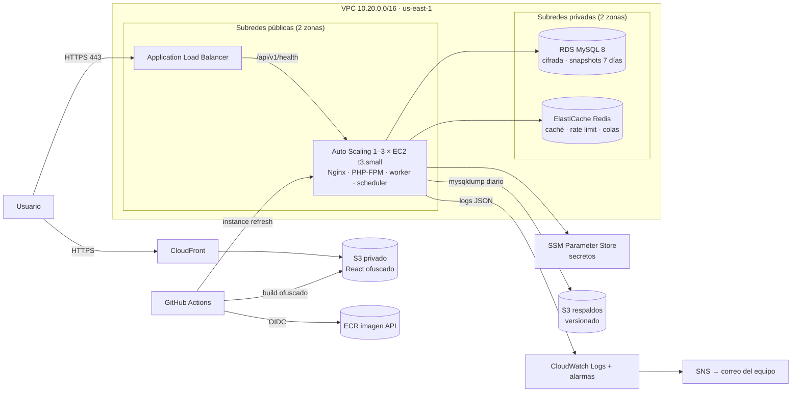

# Arquitectura de LeGrandHotel

El usuario solo llega a CloudFront (sitio web) y al balanceador (API). La API corre en EC2;
la base de datos y Redis no tienen acceso desde internet. GitHub Actions despliega, CloudWatch
recibe los logs y S3 guarda los respaldos.

## Security Groups

| Grupo | Entrada permitida |
| --- | --- |
| `alb` | 443 y 80 (80 solo redirige a HTTPS) desde internet |
| `app` (EC2) | 80 únicamente desde el SG del ALB |
| `db` (RDS) | 3306 únicamente desde el SG `app` |
| `redis` | 6379 únicamente desde el SG `app` |

## Monorepo

| Carpeta | Contenido |
| --- | --- |
| `api/` | Laravel 12 (PHP 8.2+/8.3 en Docker), Sanctum, Socialite, Pest, Laravel Boost |
| `web/` | React 18 + TypeScript + Vite, React Router, TanStack Query, Axios, Vitest |
| `infra/` | Terraform, Docker (Nginx, compose de producción), CloudWatch, scripts de respaldo |
| `tests/k6/` | Pruebas de carga, estrés, pico, resistencia y smoke |
| `docs/` | Diagramas, endpoints, pruebas, incidentes, seguridad, migración |
